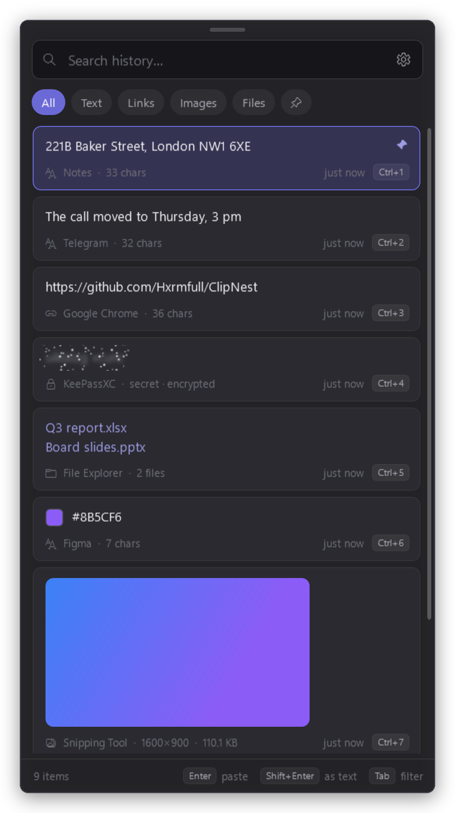

# ClipNest

Clipboard history for Windows without limits: a replacement for the built-in Win+V panel.

[Русская версия](README.ru.md)

<p align="center"></p>

## Features

- Unlimited history: no cap on the number or the size of items, and it survives a reboot.
- Opens with Win+V instead of the built-in panel, keeps the focus in your app, pastes with a click or Enter.
- Instant search and filters: text, links, images, files, pinned.
- Passwords, tokens and card numbers are hidden under a spoiler; the OCR edition finds them on screenshots too.
- The history is encrypted and never leaves your computer.
- Pinning, quick paste with Ctrl+1…9, paste without formatting, text transformations.
- Retention by days or by number of items.

## Installation

Download one of the two editions from [Releases](https://github.com/Hxrmfull/ClipNest/releases/latest)
(they share their data, so you can switch at any time):

| Edition | File | Size |
|---|---|---|
| Standard | `ClipNest.exe` | ~3 MB |
| With OCR: also finds secrets on images | `ClipNest-OCR.exe` | ~29 MB |

Requires Windows 10 or 11 (64-bit) and the [.NET 8 Desktop Runtime](https://dotnet.microsoft.com/download/dotnet/8.0).
On the first start ClipNest offers to move itself to `%LOCALAPPDATA%\Programs\ClipNest` and add itself to the Start menu.
Run the exe: ClipNest goes to the tray and starts with Windows from then on.

## Usage

Press Win+V, type to search, press Enter to paste. The settings are behind the gear in the window or in the tray icon's menu;
updates are installed from there too (Updates → Check for updates).

| Key | Action |
|---|---|
| Win+V | open / close |
| ↑ ↓ | select |
| Enter | paste |
| Shift+Enter | paste as plain text |
| Ctrl+1…9 | paste an item by its number |
| Ctrl+P | pin / unpin |
| Ctrl+H | show / hide a secret |
| Del | delete |
| Tab | next filter |
| Esc | clear the search / close |

## Building

Requires the .NET 8 SDK.

```
dotnet publish -c Release -r win-x64 --self-contained false -p:PublishSingleFile=true -p:IncludeNativeLibrariesForSelfExtract=true -p:ClipNestOcr=false -o publish
dotnet publish -c Release -r win-x64 --self-contained false -p:PublishSingleFile=true -p:IncludeNativeLibrariesForSelfExtract=true -p:ClipNestOcr=true -o publish-ocr
```

## License

[GPL-3.0](LICENSE)
