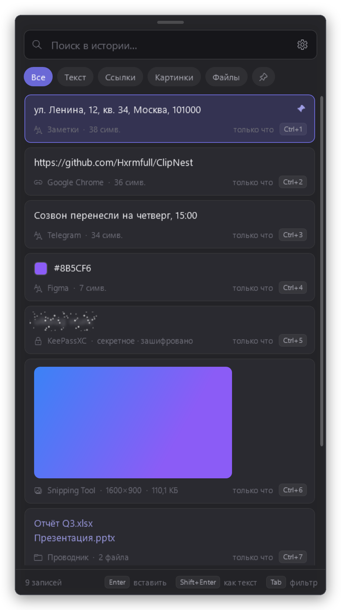

# ClipNest

История буфера обмена Windows без ограничений: замена встроенной панели Win+V.

[English version](README.md)

<p align="center"></p>

## Возможности

- История без лимитов по числу записей и размеру, сохраняется после перезагрузки.
- Открывается по Win+V вместо встроенного буфера, не забирает фокус, вставка кликом или Enter.
- Мгновенный поиск и фильтры: текст, ссылки, картинки, файлы, закреплённые.
- Пароли, токены и номера карт скрыты спойлером; в версии с OCR — и на скриншотах.
- История зашифрована и не покидает компьютер.
- Закрепление, быстрая вставка Ctrl+1…9, вставка без форматирования, преобразования текста.
- Срок хранения по дням или по числу записей.

## Установка

Скачайте одну из двух версий в [Releases](https://github.com/Hxrmfull/ClipNest/releases/latest)
(данные у них общие, переходить можно в любой момент):

| Версия | Файл | Размер |
|---|---|---|
| Обычная | `ClipNest.exe` | ~3 МБ |
| С OCR: ищет секреты и на картинках | `ClipNest-OCR.exe` | ~29 МБ |

Нужны Windows 10 или 11 (64-бит) и [.NET 8 Desktop Runtime](https://dotnet.microsoft.com/download/dotnet/8.0).
Запустите exe: ClipNest появится в трее и дальше будет запускаться вместе с Windows.

## Использование

Нажмите Win+V, начните печатать для поиска, Enter — вставить. Настройки — шестерёнка в окне или меню значка в трее.

| Клавиша | Действие |
|---|---|
| Win+V | открыть / закрыть |
| ↑ ↓ | выбор |
| Enter | вставить |
| Shift+Enter | вставить без форматирования |
| Ctrl+1…9 | вставить запись по номеру |
| Ctrl+P | закрепить / открепить |
| Ctrl+H | показать / скрыть секрет |
| Del | удалить |
| Tab | следующий фильтр |
| Esc | очистить поиск / закрыть |

## Сборка

Нужен .NET 8 SDK.

```
dotnet publish -c Release -r win-x64 --self-contained false -p:PublishSingleFile=true -p:IncludeNativeLibrariesForSelfExtract=true -p:ClipNestOcr=false -o publish
dotnet publish -c Release -r win-x64 --self-contained false -p:PublishSingleFile=true -p:IncludeNativeLibrariesForSelfExtract=true -p:ClipNestOcr=true -o publish-ocr
```

## Лицензия

[GPL-3.0](LICENSE)
